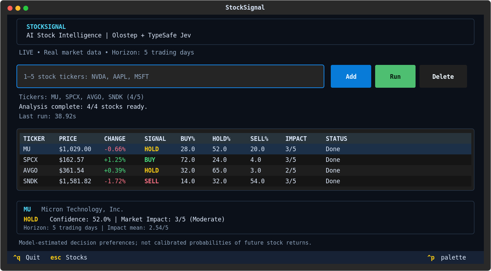
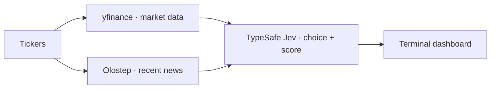

# StockSignal

**AI stock signals, right in your terminal.**

Analyze up to 5 stocks with **yfinance**, the **Olostep Python SDK** and the **TypeSafe Python SDK (Jev)**. Get color-coded BUY / HOLD / SELL decisions, probability breakdowns, market impact and news links for a **5-trading-day horizon**.



## Quick start

Requires [uv](https://docs.astral.sh/uv/) and Python 3.11–3.13 (Olostep SDK compatibility).

```bash
uv sync
```

Copy `.env.example` to `.env` and add your keys (see [Get API keys](#get-api-keys) below):

```env
OLOSTEP_API_KEY=your_key_here
JEV_API_KEY=your_key_here
```

```bash
uv run app
```

Enter 1–5 tickers, then press **R**. **A** add · **D** delete · **↑/↓** select · **Esc** focus stocks · **R** refresh · **Q** quit.

Try the dashboard without keys: `uv run app --demo`.

## Get API keys

- **Olostep:** [Sign up](https://www.olostep.com/auth) with Google or email, then generate a key under [API Keys](https://www.olostep.com/dashboard/api-keys). Save it as `OLOSTEP_API_KEY` in `.env`. The [free trial](https://www.olostep.com/pricing) includes 500 successful requests, with no credit card required.
- **TypeSafe Jev:** [Sign up](https://console.typesafe.ai/) with Google or email, then create a key under [API Keys](https://console.typesafe.ai/keys). Save it as `JEV_API_KEY` in `.env`. Check trial credits and billing in the console; API usage may require payment.

`yfinance` needs no key. Keep `.env` private and restart the app after changing keys.

## How it works



**Market impact (1–5)** rates the significance of recent developments, from Very Low to Critical. **Confidence** is the selected signal's model-estimated preference. These preferences are **not calibrated probabilities of future returns**.
